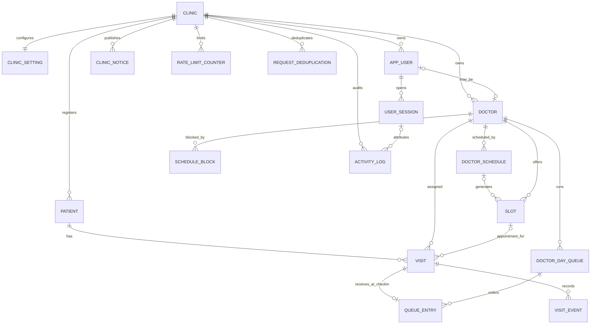

# QueueLess database design (Phase 2)

PostgreSQL is the shared contract for clinic, scheduling, appointment, and queue data. Migrations use plain SQL and `pg`; no ORM or application routes are introduced here. This schema is for synthetic development data only. The authoritative `QueueLess_SRS_v1_1.pdf` was referenced in the task but was not present in the supplied attachments or repository. The mapping below follows the detailed DB-1–DB-11 and entity requirements pasted with the task; confirm it against SRS Sections 5, 8, 9, and 10 before real implementation or data.

## Tables and relationships

| Table                   | Purpose                                                                                                         | Ownership / key relationships                                                               |
| ----------------------- | --------------------------------------------------------------------------------------------------------------- | ------------------------------------------------------------------------------------------- |
| `clinic`                | Tenant and clinic timezone                                                                                      | Root; UUID PK                                                                               |
| `clinic_setting`        | Proposed clinic timing, booking, lockout, refresh, sweep, consultation defaults, plus nullable retention values | One-to-one clinic; retention is intentionally unset                                         |
| `app_user`              | Staff identity, role, password hash, lockout and temporary-password controls                                    | Clinic-scoped unique username; logical SRS entity `User` (avoids SQL `USER` keyword)        |
| `user_session`          | Hashed session token, idle/absolute expiry and invalidation                                                     | Clinic and staff; does not store raw token                                                  |
| `doctor`                | Doctor profile linked optionally to staff account                                                               | Clinic-scoped; one staff account per doctor at most                                         |
| `doctor_schedule`       | Recurring weekly availability template                                                                          | Doctor; effective dates and duration                                                        |
| `schedule_block`        | One-off doctor unavailability                                                                                   | Doctor and optional staff creator                                                           |
| `slot`                  | Concrete appointment time for doctor                                                                            | Doctor and optional schedule; unique doctor start time                                      |
| `patient`               | Minimal patient/contact record                                                                                  | Clinic-scoped; guardian name only when marked minor                                         |
| `visit`                 | Business record and sole owner of visit status                                                                  | Patient, doctor and optional appointment slot; visit type distinguishes Appointment/Walk-in |
| `doctor_day_queue`      | One shared doctor queue per clinic day and its state/counters                                                   | Unique clinic + doctor + date; serialized transaction lock target                           |
| `queue_entry`           | Queue order, queue number, effective time, priority, skip count, lifecycle times, backfill and paper reference  | Zero or one per visit; deliberately has no status column                                    |
| `visit_event`           | Visit history, status transition, localized message key and backfill marker                                     | Visit and optional actor; immutable historical rows by convention                           |
| `clinic_notice`         | Public or emergency notices                                                                                     | Clinic and optional staff creator                                                           |
| `activity_log`          | Append-only administrative/security audit record                                                                | Clinic, optional staff/session; no patient contact fields are modeled                       |
| `rate_limit_counter`    | Expiring counters keyed by 32-byte hashed technical key                                                         | Clinic; plaintext identifiers are not stored                                                |
| `request_deduplication` | Supporting idempotency receipt for Phase 3 requests                                                             | Unique clinic + operation + key; payload digest and replay response                         |
| `schema_migrations`     | Runner-owned migration/checksum history                                                                         | Separate operational metadata, not a business table                                         |

All timestamps are `timestamptz`; application event timestamps must be generated in UTC. The clinic timezone defaults to `Africa/Addis_Ababa`; presentation and clinic-day calculations belong in the application layer. Recurring opening times are local `time` values, while concrete slot/block/event instants are timestamps.



Composite `(clinic_id, id)` keys and composite foreign keys prevent cross-clinic links for staff, sessions, doctors, schedules, slots, visits, queues, and audit actors. Restrictive delete behavior preserves visit and audit history. `doctor_schedule` is a recurring template; schedule generation and overlap validation remain service responsibilities.

## Invariants, indexes, and traceability

| Requirement                             | Implementation / responsibility                                                                                                                                   |
| --------------------------------------- | ----------------------------------------------------------------------------------------------------------------------------------------------------------------- |
| DB-1 active appointment slot uniqueness | Partial unique `visit_one_active_appointment_per_slot_uq`; canceled visit frees slot                                                                              |
| DB-2 booking reference                  | Unique `visit.booking_ref`, length at least 10; Phase 3 generates with cryptographic randomness and retries rare collisions                                       |
| DB-3 entry cardinality                  | `UNIQUE(queue_entry.visit_id)`; no queue entry is required for a booked visit                                                                                     |
| DB-4 doctor concurrency                 | Partial unique indexes for `Called` and `In Consultation`, scoped by clinic + doctor                                                                              |
| DB-5 daily queue identifiers            | Unique doctor-day queue; unique clinic/doctor/date/queue number and sequence; trigger makes queue identity and numbers immutable and prohibits deleting history   |
| DB-6 paper references                   | Partial unique clinic/date/paper reference index when non-null                                                                                                    |
| DB-7 integrity                          | FKs, visit status CHECK, skip count 0–2, positive times/counters, clinic-safe relationships, restrictive deletes, slot/visit and queue/visit consistency triggers |
| DB-8 active appointments per phone      | Phase 3 contract below; cannot be made reliable by a row CHECK                                                                                                    |
| DB-9 queue operation                    | Phase 3 transaction contract below; DB provides queue row, visit version and event/audit tables                                                                   |
| DB-10 privileges                        | Roles and grant recipe below; application role must not own schema or activity table                                                                              |
| DB-11 time storage                      | `timestamptz`; application writes UTC and displays in the configured clinic timezone                                                                              |

The only visit statuses are `Booked`, `Waiting`, `Called`, `In Consultation`, `Completed`, `Cancelled`, and `No-Show`. `Skipped` is an event type in `visit_event`, never a visit status; the associated queue row increments `skip_count` (0–2). The database verifies status vocabulary, not every permitted transition. Free-text reasons are administrative only and must never include diagnoses, symptoms, or other medical detail.

Other indexes support active sessions, schedule lookup, slot/doctor time lookup, clinic patient history, doctor-day visit filtering, queue ordering, visit event history, current notices, audit chronology, expiring rate counters, and idempotency cleanup. Partial indexes are documented next to their creation in the SQL migrations.

## Required Phase 3 transactions (not implemented here)

### Active appointment cap by phone

Normalize the phone number in the application, then in one transaction acquire `SELECT pg_advisory_xact_lock(hashtextextended($normalized_phone, 0))`; count that phone's active future visits for the clinic (excluding `Cancelled` and `No-Show`, using the configured booking horizon/cap); reject at the configured limit; insert the appointment and commit. All code paths must use the same normalization and lock key. Retry booking-reference unique collisions. The service test must run competing bookings on independent connections and prove that the configured cap is not exceeded.

### Check-in, walk-in, and queue operations

For a booked check-in, begin a transaction, lock the matching `doctor_day_queue` row with `SELECT ... FOR UPDATE`, compare the submitted `visit.version`, check authorization and allowed transition, allocate monotonic queue identifiers by updating the queue row counters with `UPDATE ... RETURNING`, move the visit to `Waiting`, create its sole `queue_entry`, increment visit version, append `visit_event` and `activity_log`, and commit. A walk-in visit and its queue entry must be inserted together in that transaction. Queue numbers are never reused; do not delete or renumber queue rows. Rejected stale versions return a conflict without partial writes.

Every mutating request accepts a stable idempotency key. In the same transaction, insert `(clinic_id, operation_scope, request_key, payload_sha256)` in `request_deduplication`; the unique key arbitrates concurrent duplicate requests. A repeated key with the same payload replays the stored response; the same key with a different digest is rejected. Store the result before commit. Retention/expiry policy for request receipts needs an explicit operational decision.

### Database roles

Use a dedicated owner/migration role and a separate application login. The migration role owns the schema; the app role gets only `CONNECT`, schema `USAGE`, required table DML, and sequence usage. Do not grant schema `CREATE`, ownership, or superuser. Explicitly revoke `UPDATE` and `DELETE` on `activity_log`; the migration also installs an immutability trigger. The trigger is defense in depth, not a substitute for roles. Run role setup only in this dedicated database and do not alter unrelated/shared roles. `scripts/setup-db.sh` creates only a missing, clearly named `*_dev` database and never creates roles or sets passwords.

For a new, dedicated local database, create the `queueless_owner` and `queueless_app` logins securely, create the database, and run the initial migrations as owner first. Then connect as database owner and apply the scoped grants (repeat default privileges for each future migration owner):

```sql
REVOKE CREATE ON SCHEMA public FROM PUBLIC;
GRANT CONNECT ON DATABASE queueless_dev TO queueless_app;
GRANT USAGE ON SCHEMA public TO queueless_app;
GRANT SELECT, INSERT, UPDATE ON ALL TABLES IN SCHEMA public TO queueless_app;
REVOKE ALL ON TABLE public.schema_migrations FROM queueless_app;
REVOKE UPDATE, DELETE ON TABLE public.activity_log FROM queueless_app;
REVOKE UPDATE, DELETE ON TABLE public.visit_event FROM queueless_app;
GRANT USAGE, SELECT ON ALL SEQUENCES IN SCHEMA public TO queueless_app;
ALTER DEFAULT PRIVILEGES FOR ROLE queueless_owner IN SCHEMA public
  GRANT SELECT, INSERT ON TABLES TO queueless_app;
ALTER DEFAULT PRIVILEGES FOR ROLE queueless_owner IN SCHEMA public
  GRANT USAGE, SELECT ON SEQUENCES TO queueless_app;
```

This grants `UPDATE` only to tables that exist at provisioning time. New tables receive `SELECT` and `INSERT` by default; review each later migration and grant `UPDATE` only where its application behavior requires it. Never grant history-table updates. The migration runner removes all `queueless_app` access from `schema_migrations` when it connects.

## Migration, setup, seed, and test workflow

1. Install local PostgreSQL and create dedicated `queueless_dev` and `queueless_test` databases with an owner and separate application role. Securely set role passwords interactively (`psql` `\password`); do not put credentials in SQL or commit `.env`.
2. `PG_ADMIN_URL=... npm run db:setup` creates `queueless_dev` only if missing. It does not alter roles, passwords, or existing databases.
3. Copy `.env.example` to `.env`; set `DATABASE_URL` to the application login and `MIGRATION_DATABASE_URL` to the local owner login. Migration/seed tooling uses the latter. Use `APP_MODE=demo` only for synthetic seed development.
4. `npm run migrate` applies numbered SQL files in lexical order. Each migration and its SHA-256 history record share one transaction. A PostgreSQL advisory lock serializes runners. A failed migration rolls back and stops; checksums catch edits and the runner refuses missing applied files.
5. Apply the privilege recipe above against the dedicated development database, then `APP_MODE=demo npm run seed` runs repeatable fixed-ID synthetic fixtures. Seeding is rejected unless the connected database is local, ends in `_dev` and `APP_MODE=demo`.
6. Point `MIGRATION_DATABASE_URL` at a dedicated local database ending in `_test`, then run `npm run test:db`. Tests refuse other database names and use real PostgreSQL constraints. Do not point it at dev or production.
7. `scripts/reset-dev-db.sh` is destructive, requires a database name ending `_dev` and exact typed confirmation, and recreates only that named DB using `PG_ADMIN_URL`. Then run migrations, grants, and seeds explicitly.

Rollback is forward-only. Do not edit an applied migration. For a failed transactional migration, inspect the reported SQLSTATE, correct the unapplied migration before sharing it, and rerun. For an applied schema change, write a reviewed forward repair migration. Restore from a verified backup only when the change cannot safely be repaired forward; never delete migration history or manually claim a migration succeeded. Legacy `schema_migrations` tables without checksums are rejected for manual reconciliation.

## Team schema-change contract

These Phase 2 files are `001`–`008` under `database/migrations/`. Coordinate changes in the shared database contract with backend and frontend contributors before merge. Number a new migration after the latest shared file, review tenant scoping, FK/delete behavior, index selectivity/partial predicates, migration locking/atomicity, rollback implications, data minimization, and test coverage. Never edit a migration another environment may have applied. Resolve numbering conflicts before merging by renumbering only unapplied migrations on the branch and updating their references/checksums. Backend developers should agree on SQL field names, status semantics, version checks, transaction boundaries, and idempotency before implementing repositories/services.

## Deferred and unresolved

- Verify all field details, BR-1–BR-12 transitions, DB-1–DB-11 wording, and AT-1–AT-20 against the missing SRS PDF.
- Phase 3 must implement/test status transition authorization, optimistic-version operations, phone normalization/advisory locking/cap, and idempotent response replay.
- Cross-setting validation beyond the `grace_window < no_show_deadline` constraint belongs in settings update service logic.
- Retention periods remain `NULL`; clinic/legal review must decide them. The displayed timing defaults are proposed SRS defaults, not approved clinic policy.
- No diagnoses, symptoms, medical history, medications, national ID, address, DOB, photographs, payment details, or GPS fields are modeled. Seed data is fictional; it is not approval to use patient data.
