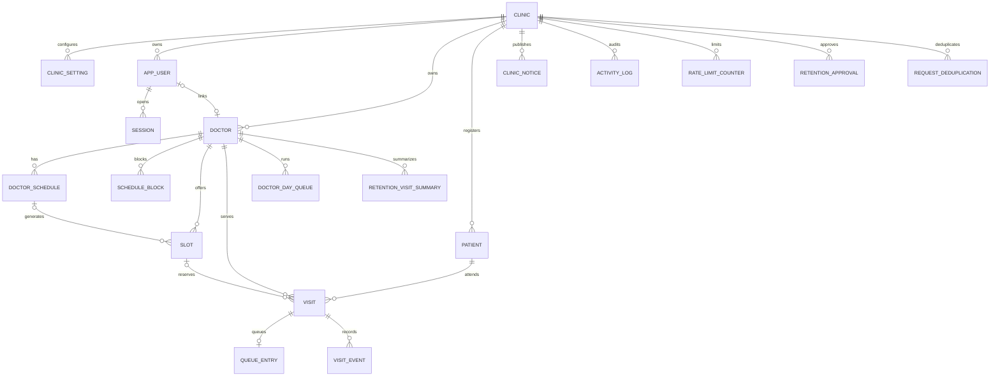

# QueueLess database design

PostgreSQL is the source of truth for clinic, scheduling, visits and queue state. The repository uses plain SQL migrations and the existing custom `pg` runner; there is no ORM or Docker requirement. All instants use `timestamptz` and the server clock (`clock_timestamp()`) supplies status-change times. A backfilled time must set `times_backfilled=true` and record its staff attribution. Clinic days and display formatting use the clinic timezone, defaulting to `Africa/Addis_Ababa`.

UUID primary keys are used for independently created clinic entities so references can be generated safely before insert and exposed without sequential IDs. `doctor_day_queue` uses its required composite `(doctor_id, queue_date)` key. `booking_ref` is a separate random public code.

## ERD



## Tables

| Table | Purpose |
| --- | --- |
| `clinic` | Single clinic identity, contact and timezone. |
| `clinic_setting` | JSON configuration, timing/booking/authentication defaults, language/mode, backup policy and nullable legal retention settings. |
| `app_user` | Dashboard display name, unique clinic username/email, role, password and lockout state. |
| `session` | Server-side hashed session, idle/absolute expiry and last activity. |
| `doctor` | Doctor name, optional specialty and optional linked staff user. |
| `doctor_schedule` | Weekly local-time availability template. |
| `schedule_block` | One-off unavailability and creator attribution. |
| `slot` | Concrete doctor appointment time. |
| `patient` | Minimum identity/contact fields only: full name, normalized nullable phone, minor flag and contact person. |
| `visit` | Patient/doctor/optional slot booking, the only status column, public reference/token and optimistic version. |
| `doctor_day_queue` | Per doctor and clinic date lock row, counters and day state. |
| `queue_entry` | Queue ordering and lifecycle timestamps; deliberately has no status. |
| `visit_event` | Visit-scoped history and patient-visible message key/unread state. |
| `clinic_notice` | Public or emergency notice. |
| `activity_log` | Append-only administrative audit events. |
| `rate_limit_counter` | Expiring counters keyed only by a 32-byte hash. |
| `retention_approval` | Administrator authorization for a retention batch. |
| `retention_visit_summary` | Aggregate JSON counts retained after approved visit removal; no patient identity. |
| `request_deduplication` | Idempotency key and payload receipt for API mutations. |
| `schema_migrations` | Custom runner checksum ledger, operational metadata rather than clinic data. |

No diagnosis, symptoms, history, medication, national ID, patient address, date of birth, photo, payment or GPS columns are present. `clinic.address` is the required clinic contact address, not a patient address. The only visit statuses are `Booked`, `Waiting`, `Called`, `In Consultation`, `Completed`, `Cancelled`, and `No-Show`; `Skipped` is an event and a queue `skip_count`, never a status.

## Foreign key delete behavior

| Relationship | Delete action | Reason |
| --- | --- | --- |
| Clinic to any clinic-owned row | `RESTRICT` | A clinic cannot be removed while its operational or audit history exists. |
| User to session | `CASCADE` | A removed user cannot retain an active server session. |
| Doctor to schedule | `CASCADE` | Recurring templates have no meaning without their doctor. |
| Doctor to visits/slots/blocks/day queues | `RESTRICT` | Preserve appointment and queue history. |
| Patient to visit | `RESTRICT` | Never lose visit history through routine patient deletion. |
| Slot to visit | `RESTRICT` | Preserve appointment linkage. |
| User to booked_by / optional creator / event actor | `SET NULL` | Retain the business/audit record after staff identity removal. |
| Visit to queue entry/event | `RESTRICT` | Only approved retention processing removes the visit and its dependents in a controlled order. |
| Approver to retention approval | `RESTRICT` | Preserve who authorized deletion. |
| Doctor to retention summary | `RESTRICT` | Keep report aggregates interpretable. |

All FKs have explicit delete behavior and supporting indexes. Normal operation never hard-deletes visits; see [retention policy](../database/retention.md).

## Indexes and the queries they serve

| Index (or index family) | Query served |
| --- | --- |
| `clinic_setting_updated_by_idx`, `*_clinic_fk_idx`, `app_user_clinic_idx` | FK checks and clinic-scoped ownership lookups. |
| `session_user_fk_idx`, `session_clinic_fk_idx`, `session_expiry_idx` | User session lookup and expired-session cleanup. |
| `doctor_user_fk_idx`, `doctor_schedule_doctor_fk_idx`, `schedule_block_doctor_fk_idx`, `schedule_block_creator_fk_idx` | Doctor ownership, schedules and block creator FK checks. |
| `slot_doctor_fk_idx`, `slot_schedule_fk_idx`, `slot_clinic_fk_idx`, `slot_start_at_idx` | Doctor/date slot listings, schedule FK checks and chronological slot lookup. |
| `patient_clinic_fk_idx`, `patient_phone_idx` | Clinic patient FK and normalized phone lookup. |
| `visit_patient_fk_idx`, `visit_doctor_fk_idx`, `visit_slot_fk_idx`, `visit_booker_fk_idx`, `visit_clinic_fk_idx` | Visit relationship checks and patient/doctor/slot/booker lookups. |
| `visit_created_at_idx`, `visit_dashboard_day_idx`, `visit_patient_lookup_idx` | Newest visits, daily doctor counts and patient visit history. |
| Unique `visit_booking_ref_uq`, `visit_status_token_idx` | Booking reference lookup and status page token lookup. |
| Unique `visit_one_active_appointment_per_slot_uq` | Enforce one non-cancelled appointment per slot and find slot conflicts. |
| Unique `visit_one_called_per_doctor_uq`, `visit_one_consultation_per_doctor_uq` | Enforce one called and one active consultation per doctor. |
| `queue_entry_doctor_fk_idx`, `queue_entry_clinic_fk_idx`, `queue_entry_visit_fk_idx`, `queue_entry_backfiller_fk_idx` | Queue FK checks. |
| `queue_entry_paper_ref_uq` | Paper ticket uniqueness per clinic day. |
| `queue_entry_board_idx` | Queue board order by doctor/day/priority/effective time/sequence. |
| `queue_entry_effective_time_idx`, `queue_entry_arrived_at_idx` | Queue time sorting and arrival lookup. |
| `queue_entry_eta_idx` | Recent completed consultation sample, excluding backfilled times. |
| `visit_event_actor_fk_idx`, `visit_event_clinic_fk_idx`, `visit_event_visit_fk_idx`, `visit_event_created_at_idx` | Event FK checks and chronological visit history. |
| Partial `visit_event_unread_idx` | Unread events for a visit (`is_read=false`). |
| `activity_log_actor_fk_idx`, `activity_log_newest_idx` | Actor FK checks and newest-first clinic audit history. |
| `rate_limit_clinic_fk_idx`, `rate_limit_expiry_idx` | Counter ownership and expired counter cleanup. |
| `retention_approval_actor_fk_idx`, `retention_approval_pending_idx` | Approval FK and pending retention review list. |
| `retention_summary_approval_fk_idx`, `retention_summary_doctor_fk_idx` | Aggregate approval and doctor FK checks. |
| `request_deduplication` unique scope index | Idempotency arbitration by clinic/operation/key. |

The complete representative query suite is [explain-dashboard.sql](../database/queries/explain-dashboard.sql). PostgreSQL may prefer sequential scans on tiny fixtures; after loading 20,000 visits and running `ANALYZE`, inspect the plans before asserting index use. For this larger fixture, expected dashboard lookups should use selective indexes rather than scan large relations; query 3 legitimately examines the 140 concrete slots in its two-week window.

## Booking and queue transactions

Generate a booking reference with `SELECT generate_booking_ref()`. It returns 12 cryptographically random characters from `ABCDEFGHJKLMNPQRSTUVWXYZ23456789` (no look-alike characters). Treat it as a public lookup code, enforce uniqueness with the DB constraint, and retry on the rare unique collision.

To enforce a per-phone booking limit, normalize the phone before entering the transaction and use the same normalized value for every booking path:

```sql
BEGIN;
SELECT pg_advisory_xact_lock(hashtextextended($1::text, 0)); -- $1 normalized phone
SELECT count(*)
FROM visit v JOIN patient p ON p.clinic_id=v.clinic_id AND p.patient_id=v.patient_id
WHERE v.clinic_id=$2 AND p.phone=$1
  AND v.type='appointment' AND v.status NOT IN ('Cancelled','No-Show')
  AND v.visit_date BETWEEN $3 AND $4;
-- Reject at the configured limit; otherwise insert and COMMIT.
COMMIT;
```

Queue mutations run in one transaction: select the matching `doctor_day_queue` row `FOR UPDATE`; compare the submitted `visit.version`; apply the allowed visit/queue change using the server clock; increment `visit.version`; insert `visit_event` and `activity_log`; commit. Allocate queue numbers from the locked day row and never reuse them. A version mismatch returns a conflict without partial writes. Walk-in visit and queue entry creation are atomic.

## Roles and migration workflow

`queueless_owner` is the DDL/migration owner. `queueless_app` has DML only, no schema `CREATE`, no DDL privileges, and no `UPDATE`/`DELETE` on `activity_log`. An append-only trigger independently rejects activity mutation. Apply [roles-and-grants.sql](../database/roles/roles-and-grants.sql) as a database administrator after migration; set passwords interactively and keep them out of files. Existing custom migration runner executes files in order as `MIGRATION_DATABASE_URL`; `npm run migrate:down` applies the latest migration's DOWN in a transaction. Every migration has UP/DOWN; the runner uses checksums to prevent silently editing an already applied migration.

`npm run seed` loads only fictional small frontend fixtures and requires local `*_dev` plus `APP_MODE=demo`. `npm run seed:large` adds a larger synthetic plan fixture for `EXPLAIN`; neither seed is production data. Passwords in the small seed are bcrypt cost 12 and are development-only (`QueueLessDemo2026!`). Retention values stay SQL NULL until legal review.
